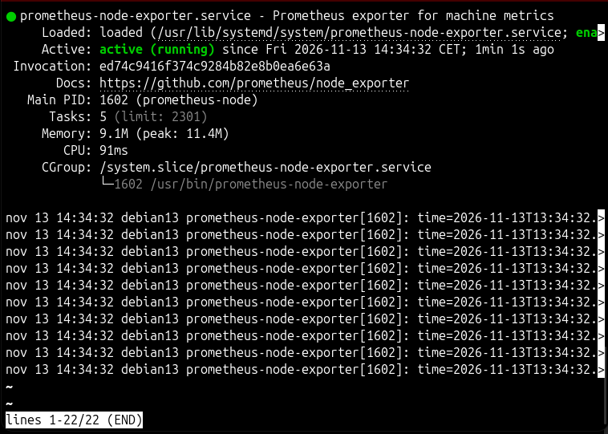
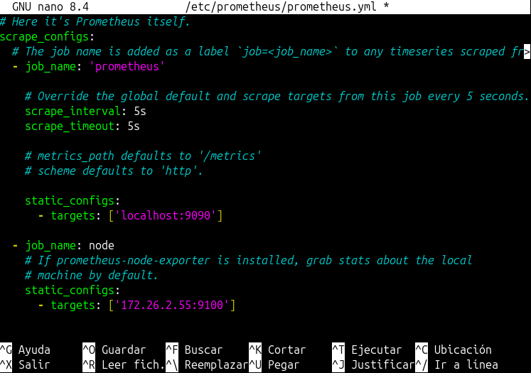
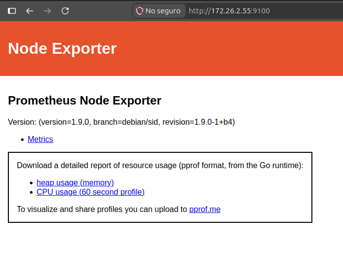
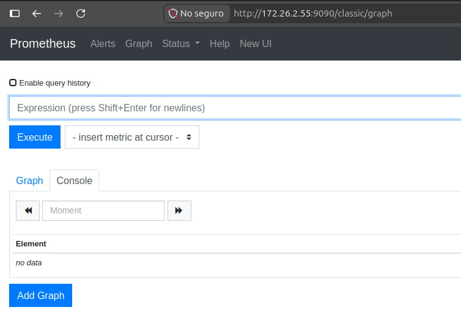
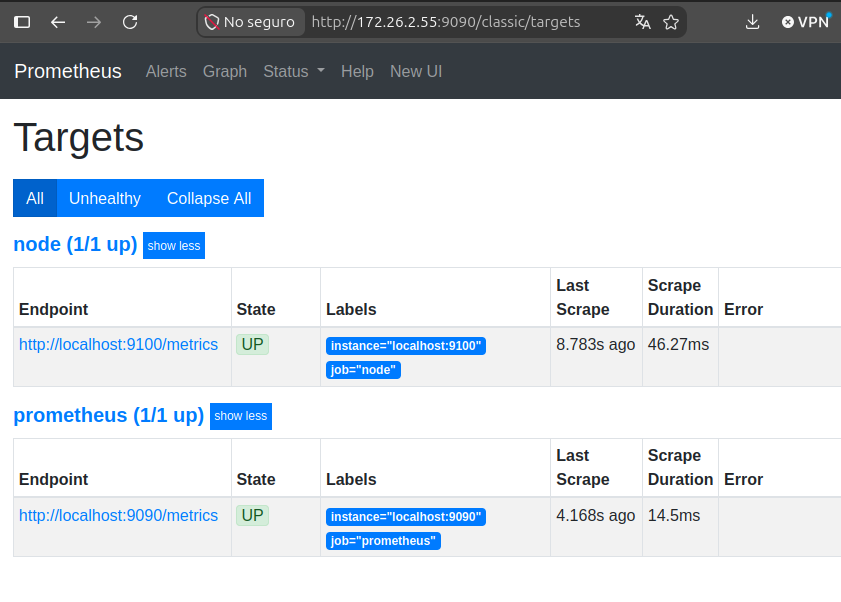
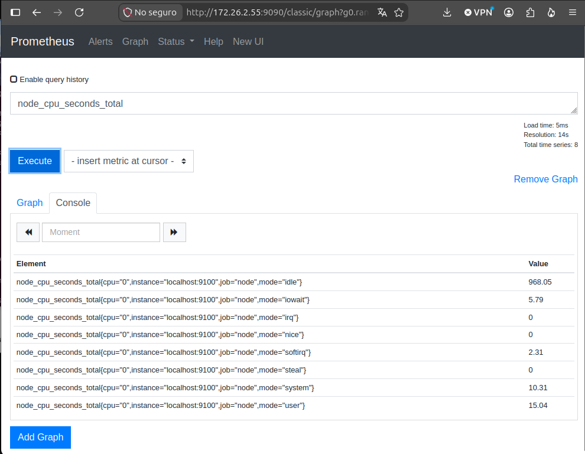
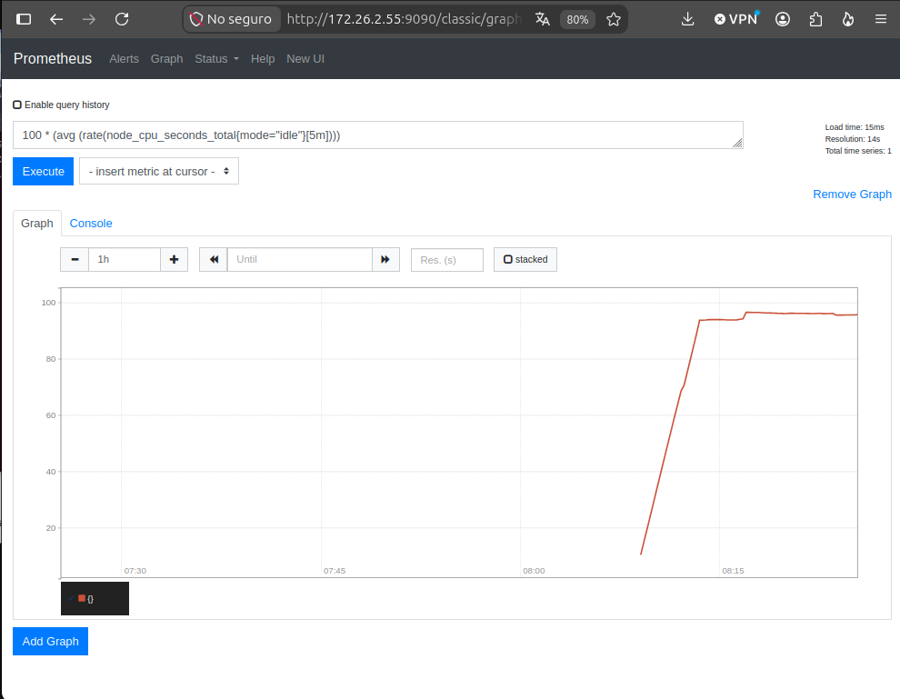

# INSTALACIÓN PROMETHEUS

Esta guía detalla el proceso de instalación y configuración de **Prometheus** y **Prometheus Node Exporter** en Debian 13.

## Instalación de los paquetes

Actualizamos los repositorios e instalamos tanto el servidor de Prometheus como el exportador de métricas del sistema (`prometheus-node-exporter`):

```bash
sudo apt update
sudo apt install prometheus prometheus-node-exporter -y
```

Comprobamos que el servicio prometheus-node-exporter está activo, habilitado al inicio y corriendo correctamente en el sistema:

```bash
sudo systemctl status prometheus-node-exporter
```



## Configuración de Prometheus

Editamos el archivo principal de configuración de Prometheus ubicado en `/etc/prometheus/prometheus.yml`:

```bash
sudo nano /etc/prometheus/prometheus.yml
```

Configuramos la sección scrape_configs para definir los objetivos (targets) de los que Prometheus recogerá métricas (el propio Prometheus en el puerto 9090 y el Node Exporter en el puerto 9100):



Guardamos los cambios (Ctrl + O, Enter y Ctrl + X en nano) y reiniciamos el servicio de Prometheus para aplicar la configuración:

```bash
sudo systemctl restart prometheus
sudo systemctl status prometheus
```

# Comprobación de Node Exporter
Abrimos el navegador y entramos en el puerto 9100 de nuestro servidor:

```
http://172.26.2.55:9100
```



Debe aparecer la interfaz de node exporter funcionando.


# Comprobación en la interfaz web de Prometheus

Abrimos el navegador y entramos en el puerto 9090 de nuestro servidor:

```
http://172.26.2.55:9090
```



Nos dirigimos al menú superior `Status > Targets` y comprobamos que tanto el `job node` como el `job prometheus` aparecen con el estado en verde `UP`:



## Consulta de métricas y visualización gráfica

Volvemos a la pestaña `Graph`, introducimos una métrica del sistema en el cuadro de expresión, por ejemplo:

```
node_cpu_seconds_total
```



Pulsamos en `Execute` y comprobamos en la pestaña Console que Prometheus está recibiendo los valores de cada núcleo y modo de CPU en tiempo real.

### Visualización en gráfica

Para comprobar que Prometheus genera gráficos históricos correctamente, probamos una expresión más elaborada que calcula el porcentaje medio de CPU inactiva en los últimos 5 minutos:

``` bash
100 * (avg (rate(node_cpu_seconds_total{mode="idle"}[5m])))
```

Cambiamos de la pestaña Console a la pestaña Graph:



Veremos la línea de evolución temporal de la métrica dibujada en pantalla, confirmando que Prometheus está almacenando series temporales y listo para conectarse con Grafana en el siguiente paso.
